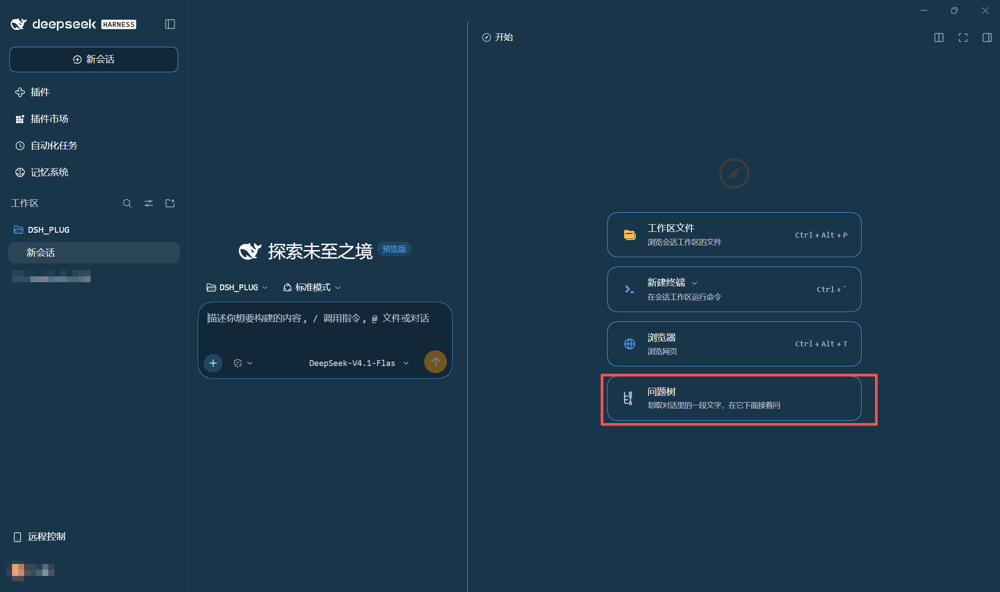
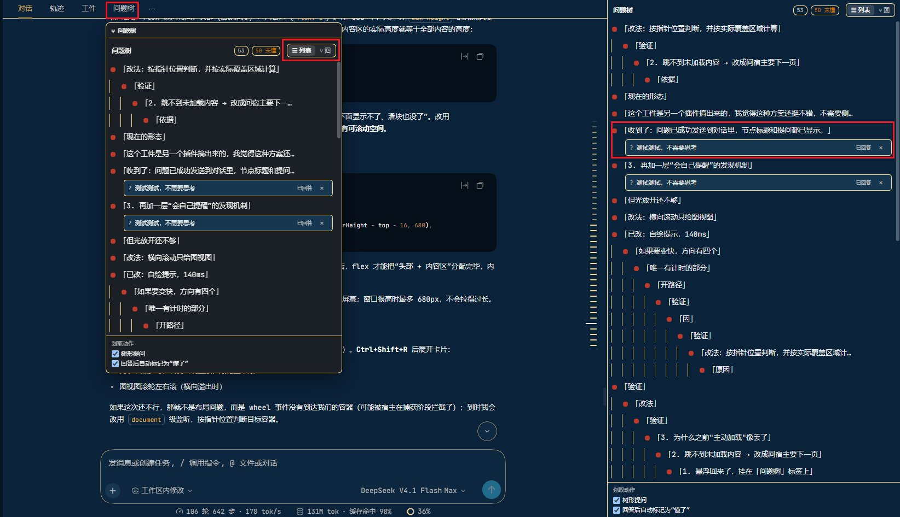
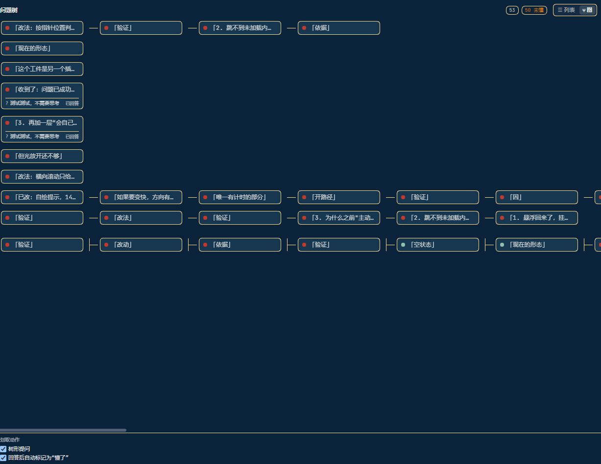
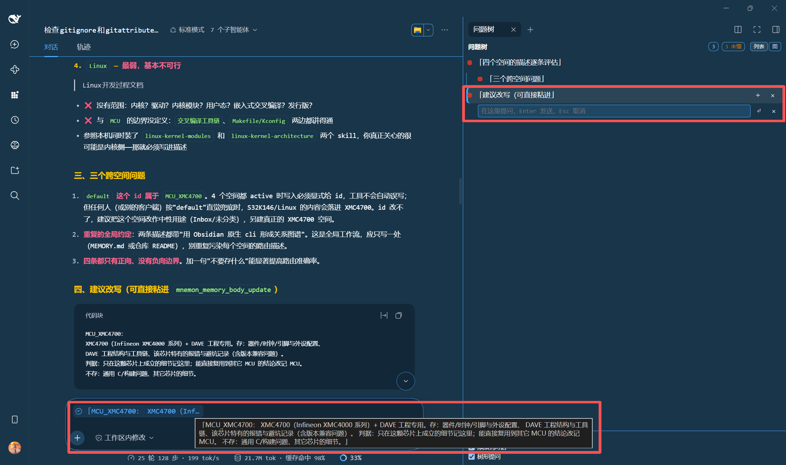

# 问题树 · DSH 插件

在对话里划一段文字，点浮出的「树形提问」，树上就多一个节点。节点下面直接写你的问题——问什么由你定，插件不预设。

树有三个入口，共用同一份数据：**顶部「问题树」标签**（整页看）、**鼠标悬停标签浮出的小卡片**（边看对话边操作）、**右栏标签页**（想常驻时用）。

它解决一件事：**长对话里，你还没搞懂的那几个点会被埋掉。** 往下追问三轮以后，原来那个没闭环的问题已经翻不出去了。这里给它一个固定位置。

## 功能

- **划词创建节点**：选中文字加入问题树则生成一个节点，节点之下可以创建子节点，也可以新建根节点，还可以将两个划词合并为一个节点
- **问题挂在节点上**：节点下的问题不是节点，是节点上的注解
- **引用自动随问题发出**：`「你划的原文」——你的问题`，「这 / 它」始终有指代对象
- **多段引用**：`Ctrl` + 点击把新选的段落追加到当前节点，一个节点可以引用多处
- **两种视图**：列表看全貌，图看分支；图会随深度向右延展，滚轮即可横向浏览
- **悬停看全文**：节点文字被截断，鼠标停一下就在下方展开完整引文
- **答完即懂**：可选的「回答后自动标记为“懂了”」，收到回答时把节点自动翻绿
- **懂没懂**：节点默认红点（还不清楚），点一下变绿（懂了），一眼看到还剩几个没闭环
- **回答状态**：`待发送 / 待回答 / 已回答`，自动跟随会话
- **回看原文**：双击节点跳回它被划出来的位置，多段引用依次循环
- **零 token**：不注册工具、不注入提示词、不写会话事件，笔记存在本地，模型看不见

## 安装

需要 DSH Desktop 桌面版 `>= 0.2.1-rc.2`。

从 GitHub 直装（插件市场里给的就是这条）：

```powershell
dsh plugin --profile desktop add github:YearnCy/dsh-question-tree
```

从 npm 安装（发布之后）：

```powershell
dsh plugin --profile desktop add -w dsh-question-tree
```

在本地改代码时，用 `file:` 指向克隆下来的目录：

```powershell
dsh plugin --profile desktop add -w "file:<本仓库路径>"
```

装完**重启 DSH**，右栏「开始」页会出现「问题树」入口（下图红框）：



## 悬浮卡片

鼠标放到上方「问题树」标签，立刻浮出问题树小卡片，效果与侧边栏完全一致——主要目的是腾出侧边栏的空间，同时更快地查看和跳转。卡片里点「列表 / 图」可以切换视图。





## 使用



- **右边红框**：在回答里划住「建议改写（可直接粘进）」这句，点一次**树形提问**，右栏就多一个节点，输入框直接开在这个节点下面，问题写在那里。这一行往上连着它的父节点，就是这次划取在树里的位置。
- **下面红框**：同一段文字如果点的是**添加到对话**，它不建节点，而是变成输入框里的一枚引用 chip，不动你已经打好的字；鼠标停在 chip 上能看到完整原文（图里那块浮层），确认无误再回车发出去。

两条路互不干扰：**问题树记位置，输入框发消息。**

> DSH 0.2.2 起，平台自己提供划词引用（原生「引用文本」按钮，消息里是 Markdown 引用块），插件就只保留「树形提问」一个按钮，不再重复那个入口。老版本上仍然是两个。

### 划词之后

1. 在对话里选中一段文字（可以很短，比如一个术语），浮出按钮栏
2. 按钮左边标着这次会挂到哪个节点下（`→ 父引文`），先看一眼再点
3. **树形提问**：建节点 + 展开输入框，用你自己的话提问，`Enter` 发送、`Esc` 取消
4. 只想把这段引用丢进输入框（0.2.1 或更早）：点**添加到对话**，只把 `「引用」` 插到光标处，不建节点、不改树

问题发出去后节点会带 `待回答`，一轮回答结束自动变 `已回答`。

### 树怎么长

新建的节点会自动成为「当前节点」，所以连着划、连着点，就是一层层往下长：

| 想要的 | 操作 |
|---|---|
| 再往下问一层 | 直接再划一段、再点「树形提问」，自动挂在上一个节点下 |
| 新开一条根 | **Alt** + 点「树形提问」 |
| 一个节点收多段引用（A、B、C 一起问） | 先选中该节点，**Ctrl** + 点「树形提问」，这段追加进去 |
| 换个地方挂 | 在树里点那一行选中它；再点同一行取消选中，下一个就回到根 |
| 回到原文 | 双击节点，跳到它被划出来的位置；多段引用每双击一次跳下一段，原文还没加载会自动往前翻页 |
| 标记「懂了」 | 点节点左侧圆点，红 ↔ 绿切换；顶栏显示还剩几个 `N 未懂` |
| 就地追问 / 删枝 | 行尾 `＋` 打开提问框，`×` 删掉它和它下面的整棵子树 |

### 问题挂在节点上

问题不是节点，是挂在这个引用上的注解：列表里显示在引用行下方的小框，图里显示在节点内部。所以连线只有一种含义——这个引用从那个引用里来，提问不会把结构画歪。

发出去的消息形如 `「你划的原文」——你的问题`，`这 / 它` 始终有指代对象；问题里已经包含那段文字时不会重复，超过 200 字才截断。

### 列表与图

- **列表**：节点按层级缩进，问题显示在所属节点下方的小框里，滚轮或右侧滚动条上下浏览
- **图**：横向分支视图，适合看整体结构；树越深画布越宽，滚轮直接横向滑动，按住 `Shift` 仍可上下

右上角是分段控件，选中项高亮；从没打开过图时按钮上有个蓝点，树真的分叉后还会有一条一次性提示。

### 三个入口

| 入口 | 打开方式 | 适合 |
|---|---|---|
| 悬浮卡片 | 鼠标停到顶部「问题树」标签上 | 边看对话边点节点跳转，最常用 |
| 视图页 | 点该标签 | 一次看完整的树 |
| 右栏标签页 | 右栏「问题树」 | 想让它常驻 |

> 视图页会接管对话区域，双击节点跳回原文时对话并未挂载，因此会提示「目标消息还没加载」。要跳转请用悬浮卡片或右栏。

### 划取动作

面板底部有一栏「划取动作」，取消勾选的动作不会出现在浮出按钮里。设置存在本地，重启仍在。

同一栏还有「回答后自动标记为“懂了”」：勾上后，某个节点的问题随轮次结束变为「已回答」时，节点会自动变绿；答得不满意再点回红点即可。默认开启。

## 数据与隐私

- 节点、问题、状态全部存在浏览器 `localStorage`，键名 `dsh.question-tree.v4.<会话 id>`
- 插件不发送任何数据，也不把树写进对话；进入上下文的只有你真正发出去的那条消息
- 删除插件不会自动清理这些记录

## 已知限制

- **仅桌面版**：依赖 DSH Desktop 的选区、视图与右栏接口
- **同一会话共享一棵树**：换会话就是另一棵树，树不跨会话合并
- **不做分支**：所有提问仍写进同一条对话流，树只是索引
- **引用走平台**：DSH 0.2.2 起，「添加到对话」用平台原生的 `insertQuote`（消息里是 Markdown 引用块，由核心的 `dsh-message-quotes` 渲染）；插件自己的 `「…」` chip 只服务「树形提问」发出的那条消息。老版本上仍整条走 chip，退化成纯文本也不影响功能

## 兼容性

- **DSH 0.2.2**：核心新增了 `@deepseek-ai/dsh-message-quotes`，它占用 user-text 规则 id `quote` 和 `conversation.user.text.node` 的键 `quote`。插件从 0.1.1 起改用 `selection-quote`，两者不再打架；同时 chip 与规则的注册都加了保护，撞名只会退化成没有 chip，不会让整个 web boot 失败
- **DSH 0.2.2 且自己画了「引用文本」时**：「添加到对话」这个按钮按帧让位，避免和原生按钮重复；按钮本身仍然注册，所以把核心 `dsh-message-quotes` 关掉的人依旧能用
- **DSH 0.2.1**：行为不变，引用仍是插件自己的 chip，两个按钮都在

## 开发

```powershell
npm run build     # 由 src/ 生成 client.js
npm run check     # 语法检查
npm test          # 模型测试 + 插件接线测试
```

源码在 `src/`：`hub.js` 负责选区与浮出栏，`tree.js` 是右栏面板，`tree-model.mjs` 是纯数据模型。改完 `npm run build`，刷新页面即可生效（只有改 `package.json` 才需要重启 DSH）。

`client.js` 是构建产物，也提交进仓库——安装时直接可用，不需要先装依赖构建。

## License

MIT © 2026 YearnCy — 见 [LICENSE](LICENSE)。
