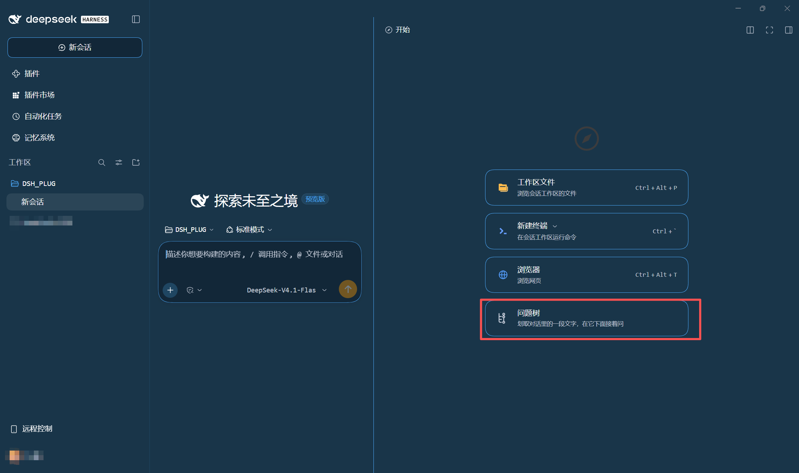
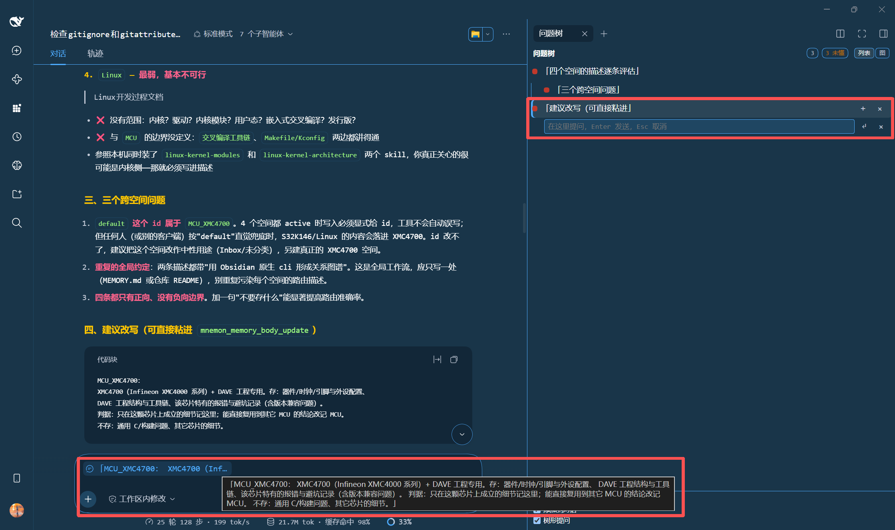

# 问题树 · DSH 右栏插件

在对话里划一段文字，点浮出的「树形提问」，右栏就多一个节点。节点下面直接写你的问题——问什么由你定，插件不预设。

它解决一件事：**长对话里，你还没搞懂的那几个点会被埋掉。** 往下追问三轮以后，原来那个没闭环的问题已经翻不出去了。这里给它一个固定位置。

## 功能

- **划词即节点**：选中的文字就是一个节点，树的连线只表示「这段引用来自那段引用」
- **问题挂在节点上**：问题不是节点，是节点上的注解，所以连线不会被提问污染
- **引用自动随问题发出**：`「你划的原文」——你的问题`，「这 / 它」始终有指代对象
- **多段引用**：`Ctrl` + 点击把新选的段落追加到当前节点，一个节点可以引用多处
- **两种视图**：列表看全貌，图看分支
- **懂没懂**：节点默认红点（还不清楚），点一下变绿（懂了），一眼看到还剩几个没闭环
- **回答状态**：`待发送 / 待回答 / 已回答`，自动跟随会话
- **回看原文**：双击节点跳回它被划出来的位置，多段引用依次循环
- **零 token**：不注册工具、不注入提示词、不写会话事件，笔记存在本地，模型看不见

## 安装

需要 DSH Desktop 桌面版 `>= 0.2.1-rc.2`。

从本仓库安装：

```powershell
dsh plugin --profile desktop add -w "file:<本仓库路径>"
```

从 npm 安装：

```powershell
dsh plugin --profile desktop add -w dsh-question-tree
```

装完**重启 DSH**，右栏「开始」页会出现「问题树」入口（下图红框）：



## 使用



- **右边红框**：在回答里划住「建议改写（可直接粘进）」这句，点一次**树形提问**，右栏就多一个节点，输入框直接开在这个节点下面，问题写在那里。这一行往上连着它的父节点，就是这次划取在树里的位置。
- **下面红框**：同一段文字如果点的是**添加到对话**，它不建节点，而是变成输入框里的一枚引用 chip，不动你已经打好的字；鼠标停在 chip 上能看到完整原文（图里那块浮层），确认无误再回车发出去。

两条路互不干扰：**问题树记位置，输入框发消息。**

### 划词之后

1. 在对话里选中一段文字（可以很短，比如一个术语），浮出按钮栏
2. 按钮左边标着这次会挂到哪个节点下（`→ 父引文`），先看一眼再点
3. **树形提问**：建节点 + 展开输入框，用你自己的话提问，`Enter` 发送、`Esc` 取消
4. **添加到对话**：只把 `「引用」` 插到光标处，不建节点、不改树

问题发出去后节点会带 `待回答`，一轮回答结束自动变 `已回答`。

### 树怎么长

新建的节点会自动成为「当前节点」，所以连着划、连着点，就是一层层往下长：

| 想要的 | 操作 |
|---|---|
| 再往下问一层 | 直接再划一段、再点「树形提问」，自动挂在上一个节点下 |
| 新开一条根 | **Alt** + 点「树形提问」 |
| 一个节点收多段引用（A、B、C 一起问） | 先选中该节点，**Ctrl** + 点「树形提问」，这段追加进去 |
| 换个地方挂 | 在树里点那一行选中它；再点同一行取消选中，下一个就回到根 |
| 回到原文 | 双击节点，跳到它被划出来的位置；多段引用每双击一次跳下一段，原文还没加载会自动往前翻页 |
| 标记「懂了」 | 点节点左侧圆点，红 ↔ 绿切换；顶栏显示还剩几个 `N 未懂` |
| 就地追问 / 删枝 | 行尾 `＋` 打开提问框，`×` 删掉它和它下面的整棵子树 |

### 问题挂在节点上

问题不是节点，是挂在这个引用上的注解：列表里显示在引用行下方的小框，图里显示在节点内部。所以连线只有一种含义——这个引用从那个引用里来，提问不会把结构画歪。

发出去的消息形如 `「你划的原文」——你的问题`，`这 / 它` 始终有指代对象；问题里已经包含那段文字时不会重复，超过 200 字才截断。

### 列表与图

- **列表**：节点按层级缩进，问题显示在所属节点下方的小框里
- **图**：横向分支视图，适合看整体结构

右上角切换。

### 划取动作

面板底部有一栏「划取动作」，取消勾选的动作不会出现在浮出按钮里。设置存在本地，重启仍在。

## 数据与隐私

- 节点、问题、状态全部存在浏览器 `localStorage`，键名 `dsh.question-tree.v4.<会话 id>`
- 插件不发送任何数据，也不把树写进对话；进入上下文的只有你真正发出去的那条消息
- 删除插件不会自动清理这些记录

## 已知限制

- **仅桌面版**：依赖 DSH Desktop 的右栏与选区接口
- **同一会话共享一棵树**：换会话就是另一棵树，树不跨会话合并
- **不做分支**：所有提问仍写进同一条对话流，树只是索引
- **输入框 chip 依赖 DSH 内部接口**：升级 DSH 后偶尔会退回成纯文本插入，功能不受影响

## 开发

```powershell
npm run build     # 由 src/ 生成 client.js
npm run check     # 语法检查
npm test          # 模型测试 + 插件接线测试
```

源码在 `src/`：`hub.js` 负责选区与浮出栏，`tree.js` 是右栏面板，`tree-model.mjs` 是纯数据模型。改完 `npm run build`，刷新页面即可生效（只有改 `package.json` 才需要重启 DSH）。

`client.js` 是构建产物，也提交进仓库——安装时直接可用，不需要先装依赖构建。

## License

MIT © 2026 YearnCy — 见 [LICENSE](LICENSE)。
